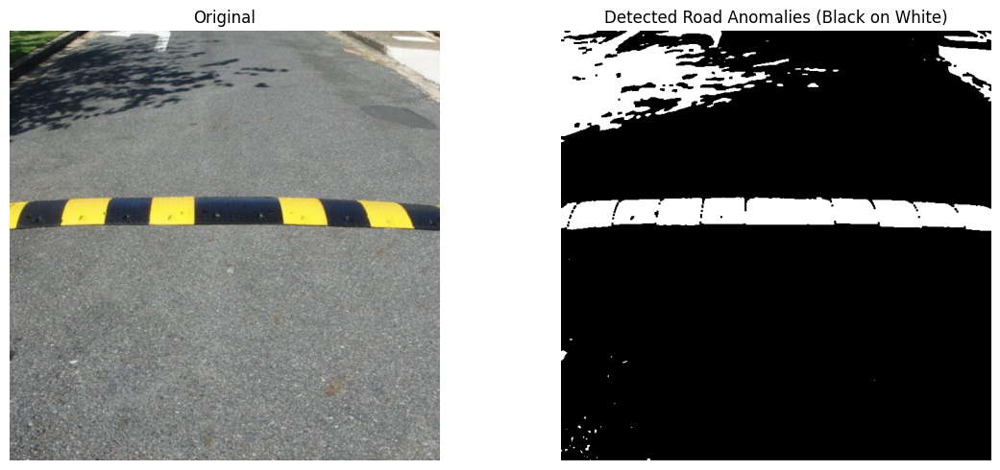
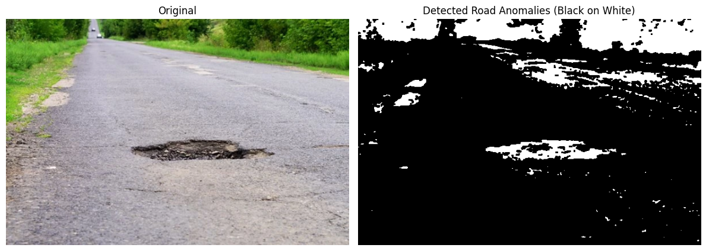
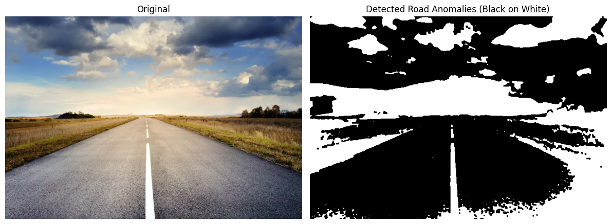

<div align="center">

<h1>VISIRoad</h1>

<p><b>Vision-Based Road Anomaly Detection System</b></p>

<p>
  A real-time road anomaly visualization system that applies classical digital image processing techniques to live camera feeds, helping highlight visual patterns associated with road surface irregularities.
</p>

<p>
  Developed as a computer vision project exploring image preprocessing, intensity-based segmentation, and real-time video processing using Python and OpenCV.
</p>

<p>
  
  
  
  
  
  
</p>

</div>

---

## Overview

**VISIRoad** is a vision-based road anomaly detection prototype developed to explore how classical computer vision techniques can be applied to road surface analysis.

The system processes video frames from an IP camera or a connected webcam, applying image preprocessing and segmentation techniques to highlight intensity-based features within the captured scene.

It uses a Flask web application to display the processed camera feed through a browser-based interface.

Unlike deep learning-based object detection systems, VISIRoad relies on traditional digital image processing techniques without requiring a trained neural network or annotated training dataset.

The project focuses on exploring real-time image processing, camera integration, and web-based visualization for potential road monitoring applications.

## System Features

### User Interface

- **Web-Based Dashboard** - A lightweight Flask-powered interface accessible through a browser.
- **Live Road Scan** - Displays a continuously processed camera feed.
- **Instructional Guide** - Includes a dedicated How to Use page.
- **Sample Outputs** - Provides visual examples of processed road surfaces, including potholes, humps, and smooth roads.
- **Simple Navigation** - Separate home, instructional, and live video pages.
- **Video Visualization** - Displays processed frames with timestamps.

### Computer Vision Functionality

- **Real-Time Frame Processing** - Processes frames captured from a video source.
- **Image Resizing** - Standardizes frame dimensions before processing.
- **Grayscale Conversion** - Converts incoming BGR frames into grayscale.
- **Gaussian Blurring** - Reduces image noise before segmentation.
- **Intensity Slicing** - Isolates pixels within a specified grayscale intensity range.
- **Binary Threshold Masking** - Produces a mask based on selected pixel intensities.
- **Morphological Filtering** - Removes isolated noise using morphological opening.
- **Image Inversion** - Inverts the processed binary image for visualization.
- **Timestamp Overlay** - Displays the processing date and time on each frame.

### Camera Integration

The application supports camera capture through OpenCV's `VideoCapture` interface.

Supported source configurations include:

- Network-based IP camera streams.
- Locally connected webcams.
- Mobile devices providing a compatible network video stream.

The video source is configured in the backend application.

## Sample Outputs

The repository includes sample images demonstrating processed road scenes.

<div align="center">

<table>
<tr>
<td align="center">
  
  <br />
  <b>Road Hump</b>
</td>
<td align="center">
  
  <br />
  <b>Pothole</b>
</td>
<td align="center">
  
  <br />
  <b>Smooth Road</b>
</td>
</tr>
</table>

</div>

These images illustrate the visual output of the image processing pipeline under different road conditions.

## Technology Stack

| Component | Technology | Purpose |
| --- | --- | --- |
| Programming Language | Python | Backend and image processing logic |
| Web Framework | Flask | HTTP routing and video streaming |
| Computer Vision | OpenCV | Camera capture and frame processing |
| Numerical Processing | NumPy | Kernel creation and numerical operations |
| Frontend | HTML5 | Web interface structure |
| Styling | CSS3 | Page layout and presentation |
| Image Processing | Classical CV techniques | Intensity segmentation and morphological filtering |
| Video Streaming | MJPEG over HTTP | Transmission of processed frames |
| Camera Input | IP Camera / Webcam | Real-time video acquisition |

## Image Processing Methodology

VISIRoad uses a sequence of digital image processing operations to transform captured road images into processed visualizations.

### 1. Frame Acquisition

The system obtains frames using OpenCV:

```python id="mhs72t"
camera = cv2.VideoCapture(camera_source)
```

The camera source can reference a network video stream or a local camera device.

### 2. Image Resizing

Incoming frames are resized so their largest dimension is 640 pixels.

This standardizes the processing resolution and reduces the amount of image data handled by subsequent operations.

### 3. Grayscale Conversion

The captured BGR image is converted into grayscale:

```python id="k3ovzh"
gray = cv2.cvtColor(frame, cv2.COLOR_BGR2GRAY)
```

Grayscale conversion reduces the image to a single intensity channel, allowing the application to perform intensity-based analysis.

### 4. Gaussian Blur

A Gaussian filter is applied to reduce noise and smooth local intensity variations:

```python id="iygc0t"
blurred = cv2.GaussianBlur(gray, (5, 5), 0)
```

The implementation uses a 5 x 5 kernel.

### 5. Intensity Slicing

The application applies intensity slicing to isolate pixels within a selected grayscale range:

```python id="7wz7nh"
lower, upper = 90, 200
mask_sliced = cv2.inRange(blurred, lower, upper)
```

Pixels with intensities within the specified range are included in the binary mask.

This provides a simple way to emphasize selected visual characteristics of the road scene.

### 6. Morphological Filtering

Morphological opening is applied to the generated mask:

```python id="053a9k"
kernel = np.ones((3, 3), np.uint8)
cleaned = cv2.morphologyEx(
    mask_sliced,
    cv2.MORPH_OPEN,
    kernel
)
```

The 3 x 3 kernel helps remove isolated pixels and small regions of noise.

### 7. Image Inversion

The cleaned binary image is inverted:

```python id="33kq1j"
result = cv2.bitwise_not(cleaned)
```

This changes the visual representation of the processed image.

### 8. Timestamp Overlay

The current date and time are rendered directly onto each processed frame.

The final frame is encoded into JPEG format and streamed to the web interface.

## Project Structure

```text id="qo7wbi"
Road-Anomalies-Detection/
├── .vscode/
│   └── settings.json
├── static/
│   ├── images/
│   │   ├── op_holes.png
│   │   ├── op_humps.png
│   │   └── op_smooth.png
│   ├── home.css
│   ├── how_to_use.css
│   └── video.css
├── templates/
│   ├── home.html
│   ├── how_to_use.html
│   └── video.html
├── app.py
└── README.md
```

### File Descriptions

| File | Description |
| --- | --- |
| `app.py` | Main Flask application, camera initialization, image processing, and video streaming |
| `templates/home.html` | Application landing page |
| `templates/how_to_use.html` | Instructions and sample road images |
| `templates/video.html` | Live processed video interface |
| `static/home.css` | Landing page styling |
| `static/how_to_use.css` | Instructional page styling |
| `static/video.css` | Video interface styling |
| `static/images/` | Sample processed road images |
| `.vscode/settings.json` | Visual Studio Code workspace settings |

## Getting Started

Follow these steps to run VISIRoad locally.

### Prerequisites

Make sure the following are installed:

- [Python](https://www.python.org/downloads/)
- [Git](https://git-scm.com/downloads)
- A webcam or compatible network camera
- A web browser

For mobile camera streaming, the phone and computer should be connected to a network that permits communication between the devices.

### 1. Clone the Repository

```bash id="2k6vwd"
git clone https://github.com/johncarlonas/Road-Anomalies-Detection.git
```

Navigate to the project directory:

```bash id="1gqtya"
cd Road-Anomalies-Detection
```

### 2. Create a Virtual Environment

**Windows (PowerShell)**

```powershell id="w364jd"
py -m venv .venv
.\.venv\Scripts\Activate.ps1
```

**macOS / Linux**

```bash id="gldjf7"
python3 -m venv .venv
source .venv/bin/activate
```

### 3. Install Dependencies

The repository does not currently contain a `requirements.txt` file.

Install the required Python packages:

```bash id="gfh3sv"
python -m pip install --upgrade pip
python -m pip install flask opencv-python numpy
```

### 4. Configure the Camera

Open `app.py` and locate the camera initialization statement.

The current implementation uses a network-based video source.

For a phone providing an IP camera stream, configure the video URL:

```python id="mdcjdn"
camera = cv2.VideoCapture(
    "http://PHONE_IP_ADDRESS:8080/video"
)
```

Replace `PHONE_IP_ADDRESS` with the phone's local IP address and adjust the port and stream path to match the camera application.

Alternatively, use a connected webcam:

```python id="myks7r"
camera = cv2.VideoCapture(0)
```

The camera index `0` commonly refers to the computer's default webcam.

### 5. Start the Flask Application

Run the Flask development server locally with its interactive debugger disabled:

```bash id="eouki3"
python -m flask --app app run --host 127.0.0.1 --port 5000 --no-debugger --no-reload
```

Open the application in your browser:

```text id="prglyd"
http://127.0.0.1:5000
```

### 6. Open the Live Video Feed

On the home page:

1. Click **Use in Road** to open the live video interface.
2. The application retrieves frames from the configured camera.
3. OpenCV processes the captured frames.
4. The processed frames appear in the browser.
5. Use the back link to return to the home page.

You can also visit the How to Use page to review the provided sample images.

## Application Routes

| Method | Route | Description |
| --- | --- | --- |
| `GET` | `/` | Renders the application home page |
| `GET` | `/how_to_use` | Displays instructions and sample images |
| `GET` | `/video` | Renders the live video interface |
| `GET` | `/video_feed` | Streams processed camera frames |

### Video Streaming

The `/video_feed` endpoint uses a multipart HTTP response to deliver JPEG-encoded frames.

The stream uses the content type:

```text id="anxkum"
multipart/x-mixed-replace; boundary=frame
```

The video page embeds this endpoint as an image source, allowing the browser to display a continuously updated feed.

## Technical Characteristics

| Property | Implementation |
| --- | --- |
| Processing Type | Classical image processing |
| Model Training | Not required |
| Camera Interface | OpenCV VideoCapture |
| Frame Resolution | Largest dimension resized to 640 pixels |
| Gaussian Kernel | 5 x 5 |
| Intensity Range | 90 to 200 |
| Morphological Operation | Opening |
| Morphological Kernel | 3 x 3 |
| Output Format | JPEG frames |
| Stream Format | MJPEG-style multipart HTTP response |
| Application Framework | Flask |

## Troubleshooting

### Camera Feed Is Not Displayed

Verify that the camera is connected and accessible.

For an IP camera:

- Confirm that the phone and computer can communicate over the local network.
- Verify the camera stream URL.
- Ensure the camera application is running.
- Check the Flask terminal for errors.

For a local webcam, try changing the camera index if the default device is unavailable.

### Application Does Not Start

Confirm that all required packages are installed:

```bash id="lzovd9"
python -m pip show flask opencv-python numpy
```

Make sure the virtual environment is activated and that Python is using the expected environment.

### Unexpected Processing Results

The visual output depends on lighting conditions, road texture, camera positioning, and the configured intensity thresholds.

The values used for intensity slicing can be adjusted experimentally to produce different processed results.

## Project Scope

VISIRoad demonstrates how traditional digital image processing techniques can be integrated into a browser-based road monitoring prototype.

The current implementation emphasizes intensity-based image segmentation rather than trained object classification.

It does not assign confidence scores, detect semantic object categories through a learned model, or independently verify road hazards.

The processing pipeline is intended for experimentation and visual analysis rather than as a validated driver assistance or road safety system.

## Future Improvements

Potential improvements include:

- Adaptive thresholding under changing lighting conditions.
- More advanced road surface segmentation.
- Region-based identification of candidate anomalies.
- Automated classification of road anomalies.
- Improved camera source selection.
- Performance monitoring and processing optimization.
- Support for recorded video uploads.
- GPS integration for mapping detected road irregularities.
- Evaluation against annotated road anomaly datasets.

## Project Background

VISIRoad was developed as a computer vision project to explore how traditional image processing techniques can be applied to real-world road scenes.

The project provided hands-on experience in capturing live camera frames, processing images using OpenCV, and integrating computer vision functionality into a web application.

Through this project, I explored:

- Real-time camera acquisition.
- Image preprocessing and noise reduction.
- Grayscale intensity analysis.
- Morphological image processing.
- Binary image manipulation.
- HTTP-based video streaming.
- Flask integration with computer vision.

The project serves as a foundation for exploring more advanced road anomaly detection approaches.

---

<div align="center">

**VISIRoad - Vision-Based Road Anomaly Detection**

A computer vision and digital image processing project.

</div>
